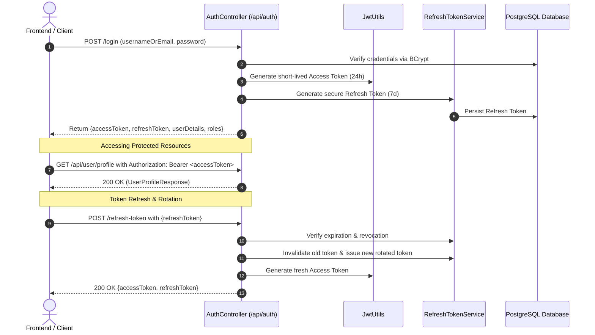

# Zephyra Auth - Backend API Documentation

Welcome to the **Zephyra Auth Service** API documentation. This service is a production-grade authentication and authorization engine built with **Java 21 LTS**, **Spring Boot**, **Spring Security 7 / 6**, and **JJWT (JSON Web Tokens)** with Access & Refresh Token rotation.

---

## 📑 Interactive Documentation (OpenAPI & Swagger UI)

When the application is running, interactive API documentation with a live **"Try it out"** console and Bearer JWT authorization is accessible at:

| Resource | URL | Description |
|---|---|---|
| **Swagger UI** | `http://localhost:8080/swagger-ui.html` | Interactive Swagger interface |
| **OpenAPI 3 Spec** | `http://localhost:8080/v3/api-docs` | OpenAPI 3.0 JSON specification |

---

## 👥 Seeded Safe Test Accounts

The service automatically seeds two test accounts on startup via `DataInitializer`:

| Role | Username | Email | Password | Granted Authorities |
|---|---|---|---|---|
| **Administrator** | `admin` | `admin@zephyra.com` | `Admin@123456` | `ROLE_ADMIN`, `ROLE_USER` |
| **Standard User** | `user` | `user@zephyra.com` | `User@123456` | `ROLE_USER` |

---

## 🔒 Authentication Flow Architecture



---

## 📡 Endpoints Reference

### 1. Public Health Check

#### `GET /api/health` or `/health`
Returns system health, version, and PostgreSQL connectivity status.

**Response `200 OK`**:
```json
{
  "status": "UP",
  "message": "Zephyra Auth Service is healthy and operational",
  "environment": "zephyra-auth",
  "databaseStatus": "CONNECTED",
  "version": "1.0.0",
  "timestamp": "2026-10-13T06:15:31.000Z"
}
```

---

### 2. Authentication Endpoints (`/api/auth`)

#### `POST /api/auth/register`
Registers a new user account.

**Request Body**:
```json
{
  "username": "johndoe",
  "email": "johndoe@example.com",
  "password": "Password@123",
  "roles": ["user"]
}
```

**Response `201 Created`**:
```json
{
  "message": "User registered successfully",
  "success": true,
  "timestamp": "2026-10-13T06:15:31.000Z"
}
```

**Validation Error `400 Bad Request`**:
```json
{
  "status": 400,
  "error": "Bad Request",
  "message": "Username is already taken",
  "path": "/api/auth/register",
  "timestamp": "2026-10-13T06:15:31.000Z"
}
```

---

#### `POST /api/auth/login`
Authenticates user credentials and issues an Access Token + Refresh Token pair.

**Request Body**:
```json
{
  "usernameOrEmail": "admin@zephyra.com",
  "password": "Admin@123456"
}
```

**Response `200 OK`**:
```json
{
  "accessToken": "eyJhbGciOiJIUzI1NiJ9...",
  "refreshToken": "8b51efd6-94e8-4660-84cf-3b9e4a8b7123",
  "tokenType": "Bearer",
  "expiresIn": 86400000,
  "id": 1,
  "username": "admin",
  "email": "admin@zephyra.com",
  "roles": [
    "ROLE_ADMIN",
    "ROLE_USER"
  ]
}
```

**Invalid Credentials `401 Unauthorized`**:
```json
{
  "status": 401,
  "error": "Unauthorized",
  "message": "Invalid username/email or password",
  "path": "/api/auth/login",
  "timestamp": "2026-10-13T06:15:31.000Z"
}
```

---

#### `POST /api/auth/refresh-token`
Exchanges an existing refresh token for a newly generated Access Token and a rotated Refresh Token.

**Request Body**:
```json
{
  "refreshToken": "8b51efd6-94e8-4660-84cf-3b9e4a8b7123"
}
```

**Response `200 OK`**:
```json
{
  "accessToken": "eyJhbGciOiJIUzI1NiJ9.new...",
  "refreshToken": "a45c71b2-11ef-42d8-9ac7-9204bf4c1001",
  "tokenType": "Bearer",
  "expiresIn": 86400000
}
```

**Expired / Invalid `403 Forbidden`**:
```json
{
  "status": 403,
  "error": "Forbidden",
  "message": "Failed for [8b51efd6-94e8-4660-84cf-3b9e4a8b7123]: Refresh token has expired. Please sign in again.",
  "path": "/api/auth/refresh-token",
  "timestamp": "2026-10-13T06:15:31.000Z"
}
```

---

#### `POST /api/auth/logout`
Revokes and invalidates the supplied refresh token.

**Request Body**:
```json
{
  "refreshToken": "a45c71b2-11ef-42d8-9ac7-9204bf4c1001"
}
```

**Response `200 OK`**:
```json
{
  "message": "Log out successful",
  "success": true,
  "timestamp": "2026-10-13T06:15:31.000Z"
}
```

---

### 3. Protected User Endpoints (`/api/user`)

*Requires header: `Authorization: Bearer <accessToken>`*

#### `GET /api/user/profile`
Returns the authenticated user's profile.

**Response `200 OK`**:
```json
{
  "id": 2,
  "username": "user",
  "email": "user@zephyra.com",
  "roles": [
    "ROLE_USER"
  ],
  "enabled": true,
  "createdAt": "2026-10-13T06:15:31.000Z"
}
```

#### `GET /api/user/dashboard`
Returns authenticated dashboard welcome and accessible features.

**Response `200 OK`**:
```json
{
  "status": "ACTIVE",
  "message": "Welcome to your Zephyra dashboard, user!",
  "user": { ... },
  "accessibleFeatures": [
    "View Profile",
    "Update Security",
    "Activity History"
  ]
}
```

---

### 4. Admin Only Endpoints (`/api/admin`)

*Requires header: `Authorization: Bearer <accessToken>` with authority `ROLE_ADMIN`*

#### `GET /api/admin/users`
Lists all registered users in the database.

**Response `200 OK`**:
```json
[
  {
    "id": 1,
    "username": "admin",
    "email": "admin@zephyra.com",
    "roles": ["ROLE_ADMIN", "ROLE_USER"],
    "enabled": true,
    "createdAt": "2026-10-13T06:15:31.000Z"
  },
  {
    "id": 2,
    "username": "user",
    "email": "user@zephyra.com",
    "roles": ["ROLE_USER"],
    "enabled": true,
    "createdAt": "2026-10-13T06:15:31.000Z"
  }
]
```

**If called without `ROLE_ADMIN` (`403 Forbidden`)**:
```json
{
  "status": 403,
  "error": "Forbidden",
  "message": "Access Denied: You do not have the required permissions to access this resource",
  "path": "/api/admin/users",
  "timestamp": "2026-10-13T06:15:31.000Z"
}
```

#### `GET /api/admin/dashboard`
Returns administrative system metrics, token counts, and recent users.

**Response `200 OK`**:
```json
{
  "totalUsers": 2,
  "totalAdmins": 1,
  "activeRefreshTokens": 2,
  "recentUsers": [ ... ]
}
```

---

## 🧪 Test Suite Summary

The project includes unit and integration tests executing against an isolated H2 in-memory PostgreSQL-mode database (`application-test.properties`).

| Test Suite | Class | Tests | Status |
|---|---|:---:|:---:|
| **Authentication Flow** | `AuthControllerTest` | 6 | ✅ PASSED |
| **Role-Based Access Control** | `RoleBasedAccessControlTest` | 5 | ✅ PASSED |
| **JWT Utilities** | `JwtUtilsTest` | 3 | ✅ PASSED |
| **Refresh Token Management** | `RefreshTokenServiceTest` | 4 | ✅ PASSED |
| **Spring Boot Context** | `BackendApplicationTests` | 1 | ✅ PASSED |
| **Total** | | **19** | **100% Pass** |

Run tests via Maven:
```powershell
.\mvnw.cmd test
```
